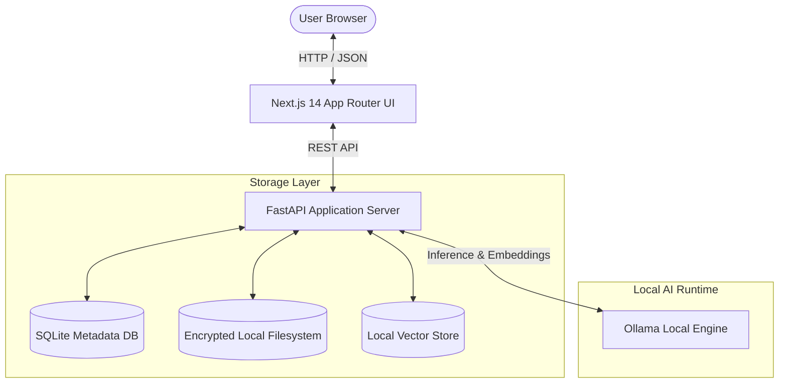

# EchoVault 🗝️

> **Keep the stories. Preserve the echoes.**
> *A private, local-first AI memory archive for the Hacktoberfest 2026 “Ghost in the Machine” challenge.*

[](LICENSE)
[](docs/AI_MODEL_CARDS.md)
[](docs/PODMAN_SETUP.md)
[](#)

---

## 📖 Overview

**EchoVault** is a private, local-first AI memory archive designed to help individuals, families, historians, and researchers preserve and rediscover personal histories.

Unlike cloud AI search tools that require sending intimate letters, family photographs, and oral histories to commercial servers, EchoVault runs **entirely on your local machine** using open-weight models (via Ollama or local containerized runtimes) and persistent local storage.

### Core Principles
1. **Evidence-Backed Retrieval:** Answers cite exact passages from uploaded letters, transcripts, or notes.
2. **Local-First Privacy:** Zero telemetry, no commercial API requirements, full offline operation.
3. **Graceful Uncertainty:** Never fabricates missing history or dates; clearly flags uncertain or contradictory sources.
4. **Model Independence:** Swap underlying open-weight models (Llama 3.2, Qwen 2.5, Mistral, Gemma 2) without rewriting your archive.
5. **Portable Archives:** One-click export to self-contained JSON and source asset zip bundles.

---

## 🏛️ System Architecture



---

## ⚡ Quick Start

### Option 1: Native Local Development

#### Prerequisites
- Node.js >= 18
- Python >= 3.10
- Ollama (Optional for live LLM inference; offline mock mode included for testing)

#### 1. Backend Setup
```powershell
cd backend
python -m venv venv
.\venv\Scripts\activate
pip install -r requirements.txt
python -m app.main
# Backend runs at http://localhost:8000 (Docs at /docs)
```

#### 2. Frontend Setup
```powershell
cd frontend
npm install
npm run dev
# Frontend runs at http://localhost:3000
```

---

### Option 2: Podman Desktop & Containers

EchoVault is built and verified for **Podman Desktop** and container-compose workflows.

```bash
# Validate compose specification
podman compose config

# Build and start services
podman compose up --build -d

# Verify services
podman compose ps
podman compose logs -f
```
*For complete instructions and host networking details, see [docs/PODMAN_SETUP.md](docs/PODMAN_SETUP.md).*

---

## 🧪 Verified Test Suite

```bash
# Run backend test suite
cd backend
pytest tests/ -v
```

---

## 📚 Complete Documentation Suite

All technical documentation is located in the [`docs/`](docs/) directory:
- [Product Requirements Document (PRD)](docs/PRD.md)
- [Technical Requirements Document (TRD)](docs/TRD.md)
- [Software Requirements Specification (SRS)](docs/SRS.md)
- [System Architecture](docs/ARCHITECTURE.md)
- [Architecture Decision Records (ADR)](docs/ADR/)
- [REST API Specification](docs/API_SPECIFICATION.md)
- [Data Dictionary & Schemas](docs/DATA_DICTIONARY.md)
- [UI/UX Specification](docs/UI_UX_SPECIFICATION.md)
- [Design System & Tokens](docs/DESIGN_SYSTEM.md)
- [Threat Model & Security](docs/THREAT_MODEL.md)
- [Security Policy](docs/SECURITY.md)
- [Privacy by Design](docs/PRIVACY.md)
- [AI Model Cards & Licenses](docs/AI_MODEL_CARDS.md)
- [Open-Source AI Rationale](docs/OPEN_SOURCE_RATIONALE.md)
- [Test Plan](docs/TEST_PLAN.md) & [Verified Results](docs/TEST_RESULTS.md)
- [Podman Desktop Setup](docs/PODMAN_SETUP.md)
- [Operations Runbook](docs/OPERATIONS_RUNBOOK.md)
- [Backup & Disaster Recovery](docs/BACKUP_AND_RECOVERY.md)
- [Hackathon Demo Script](docs/DEMO_SCRIPT.md)
- [Accessibility Guide (WCAG 2.1 AA)](docs/ACCESSIBILITY.md)
- [Performance Benchmarks](docs/PERFORMANCE.md)
- [Known Limitations & Roadmap](docs/KNOWN_LIMITATIONS.md)

---

## 🤝 Contributing

We welcome community contributions! Please review [CONTRIBUTING.md](CONTRIBUTING.md) and our [CODE_OF_CONDUCT.md](CODE_OF_CONDUCT.md) before opening a pull request.

---

## 📄 License

Licensed under the [Apache License, Version 2.0](LICENSE).
All trademarks, sample materials, and code are open-source.
