# EchoVault 🗝️

> **Keep the stories. Preserve the echoes.**  
> *A private, local-first AI memory archive built for the Hacktoberfest 2026 “Ghost in the Machine” challenge.*

[](LICENSE)
[](https://hacktoberfest.com/)
[](docs/AI_MODEL_CARDS.md)
[](docs/PODMAN_SETUP.md)
[](docs/TEST_RESULTS.md)
[](docs/PRIVACY.md)

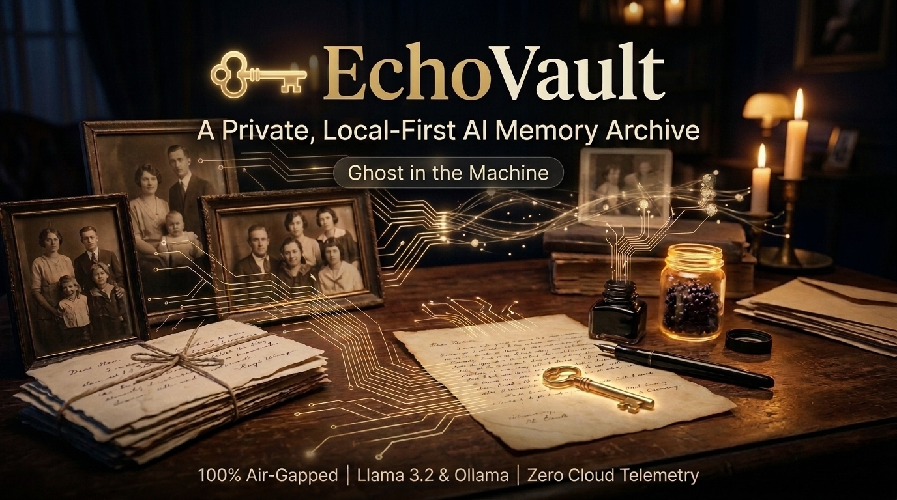

---

## 📖 Executive Summary & Mission

**EchoVault** is an air-gapped, local-first artificial intelligence memory archive engineered to help families, historians, and researchers preserve, index, and query personal histories with verifiable provenance.

Most modern AI solutions require uploading deeply personal family heirlooms—letters from wartime, handwritten recipe cards, oral history audio, and vintage portraits—to proprietary third-party clouds where data is mined, shared, or hallucinated upon. EchoVault challenges this paradigm:

1. **100% Local & Air-Gapped:** Zero telemetry, zero external API keys, zero cloud egress. Every neural inference and vector embedding runs directly on your machine via [Ollama](https://ollama.ai) or local container runtimes.
2. **Grounded RAG with Verifiable Citations:** When querying your archive, EchoVault cites exact source IDs and text excerpts. If evidence does not exist, it gracefully states uncertainty rather than fabricating memories.
3. **Historical Conflict Detection:** Rather than forcing false consensus when family accounts differ, EchoVault explicitly surfaces discrepancies (e.g. conflicting dates between a town ledger and an uncle's journal).
4. **Ethical Remembrance Sanctuary:** Dedicated remembrance tributes honoring ancestors without creepy deepfake voice simulations or generative text roleplay.
5. **Open-Weight Independence:** Swap between **Llama 3.2**, **Qwen 2.5**, or **Mistral** seamlessly without rewriting your archival data.
6. **Data Sovereignty:** One-click standalone `.zip` export bundle containing raw assets, SQLite JSON dump, and timeline metadata.

---

## 🖼️ Visual Tour & Interface Showcase

EchoVault features an editorial archival interface designed with rich typography, dark-mode glassmorphism, and responsive micro-interactions. Below is a complete visual walkthrough of the platform:

### 1. Landing Page & The Preservation Crisis

| Hero Section (`1.png`) | The Preservation Crisis (`2.png`) |
| :---: | :---: |
| 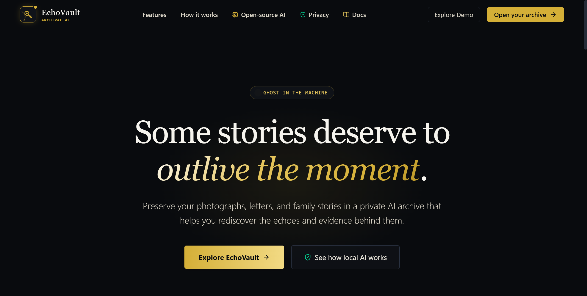 | 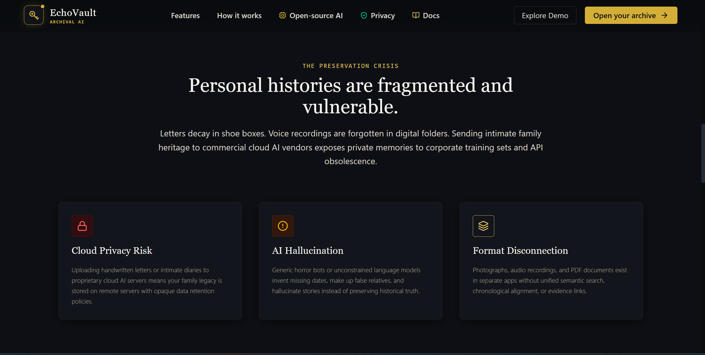 |
| *Editorial landing page featuring the "GHOST IN THE MACHINE" track badge, mission statement, and quick onboarding actions.* | *Analysis of personal history risks: Cloud Privacy Leaks, Generative AI Hallucinations, and Format Disconnection.* |

### 2. Core Archival Capabilities & Overview Dashboard

| Archival Capabilities (`3.png`) | Archive Overview Dashboard (`4.png`) |
| :---: | :---: |
| 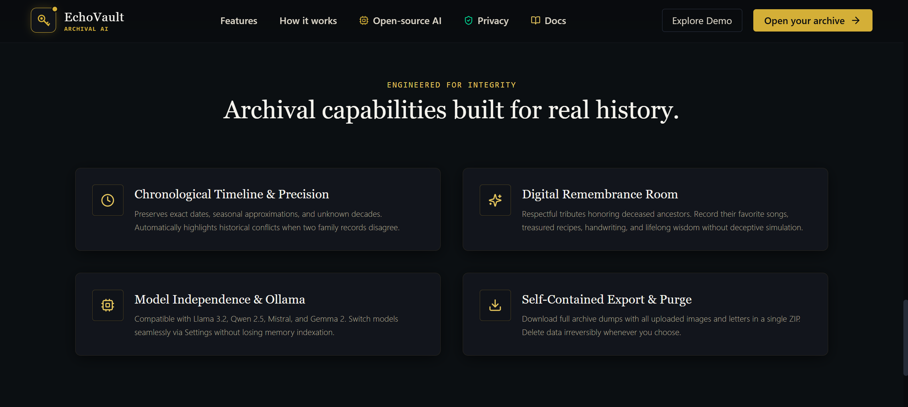 | 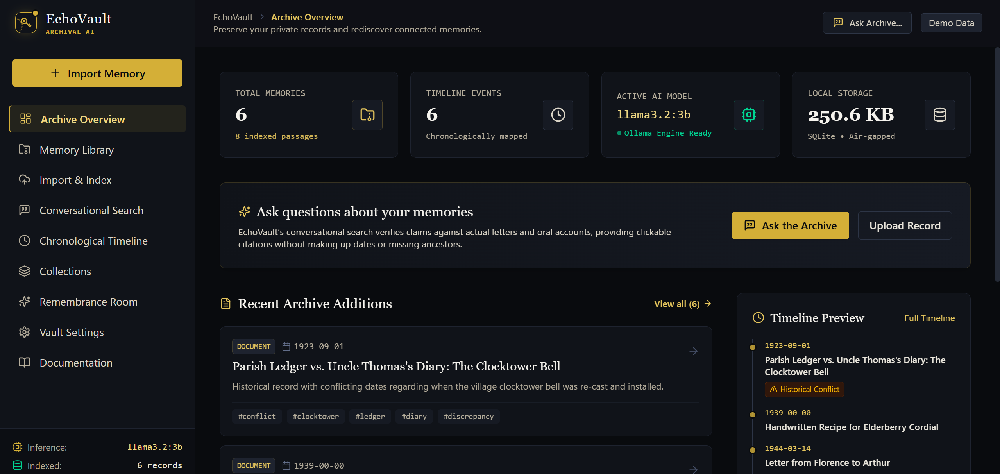 |
| *Engineered for integrity: Chronological precision, Digital Remembrance Sanctuary, Model Independence, and Self-Contained Export.* | *Live metrics dashboard displaying indexed memory count, timeline events, active LLM (`llama3.2:3b`), and local SQLite storage size.* |

### 3. Memory Library & Multi-Modal Ingestion

| Memory Library (`5.png`) | Ingestion & Metadata Tagging (`6.png`) |
| :---: | :---: |
| 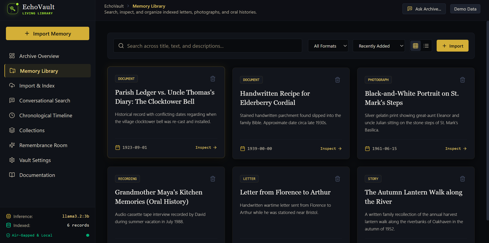 | 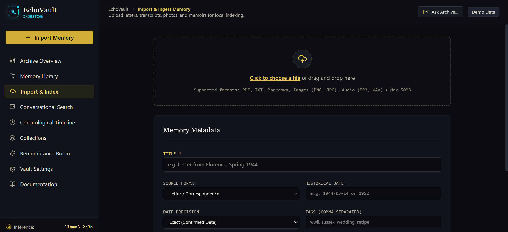 |
| *Filterable archive catalog supporting format tags (Documents, Letters, Photos, Audio, Transcripts), search query, and date sorting.* | *Drag-and-drop uploader (PDF, TXT, MD, JPG, PNG, MP3, WAV up to 50MB) with historical date precision and SHA-256 deduplication.* |

### 4. Grounded Conversational AI & Chronological Timeline

| Conversational AI Search (`7.png`) | Chronological Timeline & Conflicts (`8.png`) |
| :---: | :---: |
| 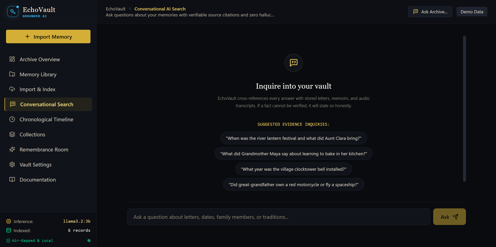 | 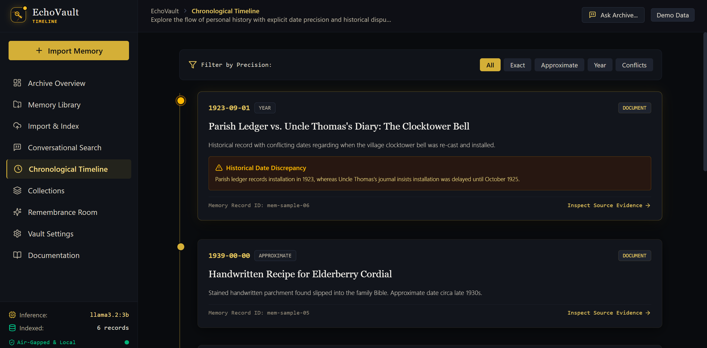 |
| *Evidence-bounded conversational search. Every answer cites exact source passages with confidence metrics and zero fabrication.* | *Chronological event sequence with precision filtering (Exact, Month, Year, Decade) and automated historical date discrepancy alerts.* |

### 5. Curated Binders & Remembrance Sanctuary

| Thematic Collections (`9.png`) | Remembrance Room Sanctuary (`10.png`) |
| :---: | :---: |
| 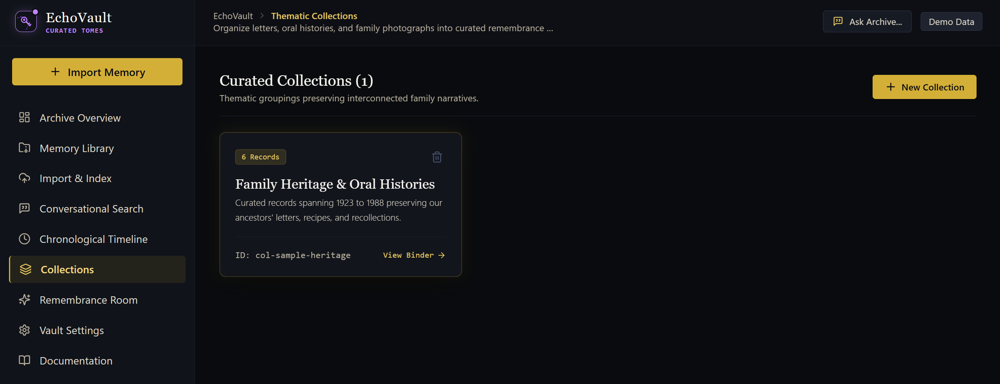 | 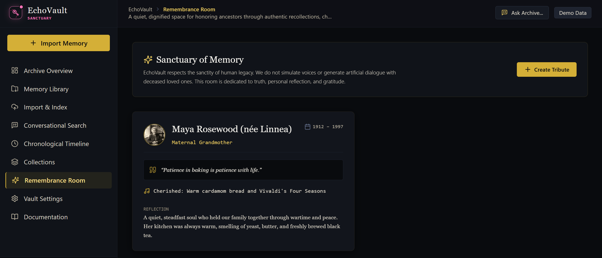 |
| *Curated archival binders grouping interconnected records (e.g., "Family Heritage & Oral Histories" spanning 1923 to 1988).* | *Dignified ancestral sanctuary honoring departed loved ones through authentic quotes and memories—strictly rejecting deceptive voice cloning.* |

### 6. Vault Settings & Synthetic Demo Sandbox

| Vault Diagnostics & Export (`11.png`) | Synthetic Archival Demo Sandbox (`12.png`) |
| :---: | :---: |
| 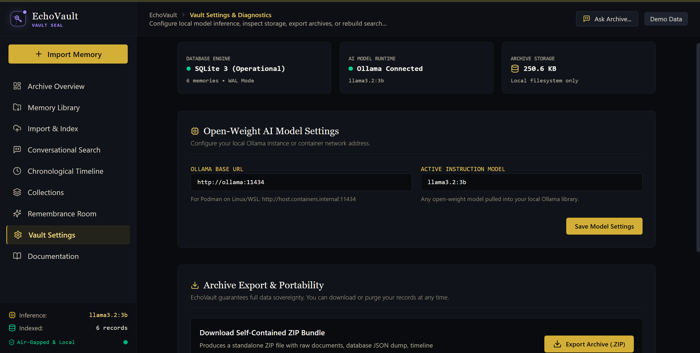 | 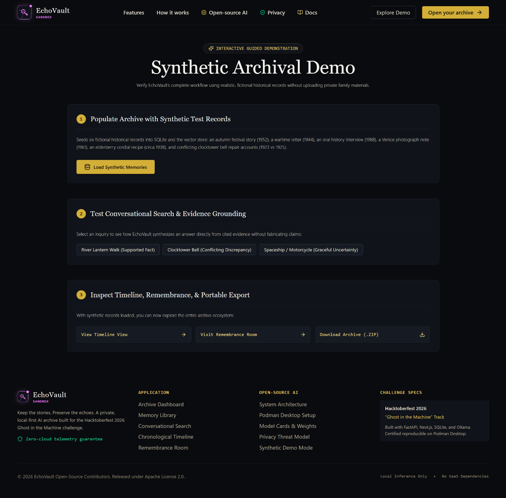 |
| *Engine status (SQLite WAL mode), local Ollama inference configuration, storage diagnostics, and one-click ZIP backup export.* | *Interactive 3-step sandbox allowing judges and users to load synthetic test records and verify RAG grounding without uploading private data.* |

---

## 🏛️ System Architecture

EchoVault follows an air-gapped three-tier local architecture ensuring strict isolation between user presentation, REST API business logic, and local AI inference:

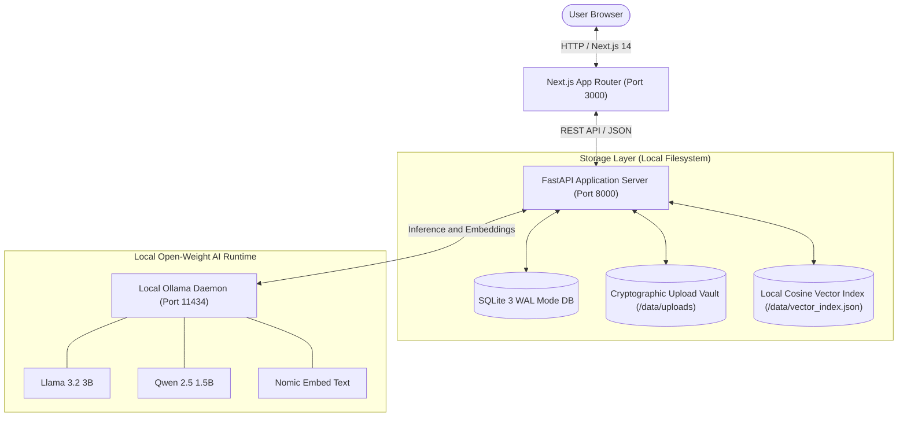

### Ingestion & Evidence Grounding Pipeline

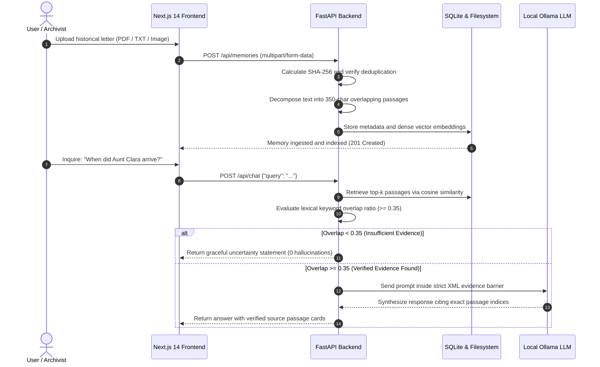

---

## ⚡ Quick Start & Deployment

EchoVault supports both containerized deployment via **Podman Desktop** and bare-metal local development.

### Option 1: Podman Desktop & Containers (Recommended)

EchoVault is container-certified and rootless by default.

```bash
# 1. Clone repository
git clone https://github.com/arnab825/EchoVault.git
cd EchoVault

# 2. Validate container specification
podman compose config

# 3. Build and launch all services in background
podman compose up --build -d

# 4. Check container health status
podman compose ps
```

Open your browser:
- **Web Application:** `http://localhost:3000`
- **Interactive Sandbox Demo:** `http://localhost:3000/demo`
- **Architectural Documentation Portal:** `http://localhost:3000/docs`
- **FastAPI OpenAPI Docs:** `http://localhost:8000/docs`

*For advanced host networking, WSL2 memory tuning, and container volume backups, see [docs/PODMAN_SETUP.md](docs/PODMAN_SETUP.md).*

---

### Option 2: Native Local Development

#### Prerequisites
- **Node.js** >= 18.0.0
- **Python** >= 3.10
- **Ollama** (optional; EchoVault contains an internal deterministic fallback if Ollama is not installed)

#### 1. Start Backend Service
```powershell
cd backend
python -m venv venv
# Windows:
.\venv\Scripts\activate
# Linux/macOS:
# source venv/bin/activate

pip install -r requirements.txt
python -m app.main
# Backend runs at http://localhost:8000
```

#### 2. Start Frontend Application
```powershell
cd frontend
npm install
npm run dev
# Frontend runs at http://localhost:3000
```

#### 3. Pull Recommended Local AI Models (via Ollama)
```bash
ollama pull llama3.2:3b
ollama pull nomic-embed-text
```

---

## 🧪 Automated Testing & Verification

EchoVault includes an end-to-end automated test suite verifying SQLite persistence, vector search, RAG evidence grounding, uncertainty handling, conflict detection, and ZIP archive export:

```bash
cd backend
pytest tests/ -v
```

**Test Coverage Results:**
- `test_health`: API status & operational readiness probes
- `test_create_memory`: Multipart upload and passage chunking
- `test_deduplication`: SHA-256 exact content conflict rejection
- `test_vector_search`: Cosine similarity ranking across passages
- `test_chat_grounded`: Synthesizes answer with valid citation indices
- `test_chat_uncertainty`: Gracefully declines answers for missing facts
- `test_timeline`: Chronological precision sorting & discrepancy flags
- `test_remembrance`: Ancestral sanctuary tribute CRUD
- `test_export_archive`: Generates standalone valid ZIP archive bundle
- `test_path_traversal_defense`: Rejects malicious file path access attempts

---

## 📚 Complete Technical Documentation Suite

The [`docs/`](docs/) directory contains 24 in-depth specifications covering every aspect of EchoVault's architecture and design:

| Specification Area | Documentation Guides |
| :--- | :--- |
| **Architecture & Decisions** | [System Architecture](docs/ARCHITECTURE.md) • [Architecture Decision Records (ADRs)](docs/ADR/) • [Data Dictionary](docs/DATA_DICTIONARY.md) |
| **Requirements & Specifications** | [Product Requirements (PRD)](docs/PRD.md) • [Technical Requirements (TRD)](docs/TRD.md) • [Software Requirements (SRS)](docs/SRS.md) |
| **API & Integrations** | [REST API Specification](docs/API_SPECIFICATION.md) • [In-App Documentation Portal](http://localhost:3000/docs) |
| **AI Models & Open Source** | [AI Model Cards & Footprints](docs/AI_MODEL_CARDS.md) • [Open-Source AI Rationale](docs/OPEN_SOURCE_RATIONALE.md) |
| **Security & Privacy** | [Threat Model](docs/THREAT_MODEL.md) • [Security Policy](docs/SECURITY.md) • [Privacy by Design](docs/PRIVACY.md) |
| **Deployment & Ops** | [Podman Desktop Setup](docs/PODMAN_SETUP.md) • [Operations Runbook](docs/OPERATIONS_RUNBOOK.md) • [Backup & Disaster Recovery](docs/BACKUP_AND_RECOVERY.md) |
| **Quality & Design** | [Test Plan](docs/TEST_PLAN.md) • [Verified Test Results](docs/TEST_RESULTS.md) • [UI/UX Specification](docs/UI_UX_SPECIFICATION.md) • [Design System](docs/DESIGN_SYSTEM.md) • [Accessibility Guide](docs/ACCESSIBILITY.md) • [Performance Benchmarks](docs/PERFORMANCE.md) |
| **Evaluation & Roadmap** | [Hackathon Demo Script](docs/DEMO_SCRIPT.md) • [Known Limitations & Roadmap](docs/KNOWN_LIMITATIONS.md) |

---

## 🎯 Hacktoberfest 2026: "Ghost in the Machine" Alignment

EchoVault was conceived and engineered for the Hacktoberfest 2026 **"Ghost in the Machine"** track:

- **The "Ghost":** The authentic digital remnants of human lives—handwritten letters, fading recipes, oral recollections, and family portraits that risk dissolution in the digital ether.
- **The "Machine":** Local, open-weight artificial intelligence (Llama 3.2, Qwen 2.5, Ollama) acting as a faithful, respectful archivist rather than a corporate monetization engine.
- **The Distinction:** EchoVault strictly avoids generative "necromancy" (no simulated voices, no chatbot impersonations of deceased relatives). Instead, it acts as an intelligent librarian that retrieves real human truth without hallucination.

---

## 🤝 Contributing

We welcome contributions from open-source developers, archivists, and privacy enthusiasts! Please see [CONTRIBUTING.md](CONTRIBUTING.md) and our [CODE_OF_CONDUCT.md](CODE_OF_CONDUCT.md) before submitting pull requests.

---

## 📄 License

Licensed under the [Apache License, Version 2.0](LICENSE).  
Copyright © 2026 EchoVault Open-Source Contributors. All rights reserved.

