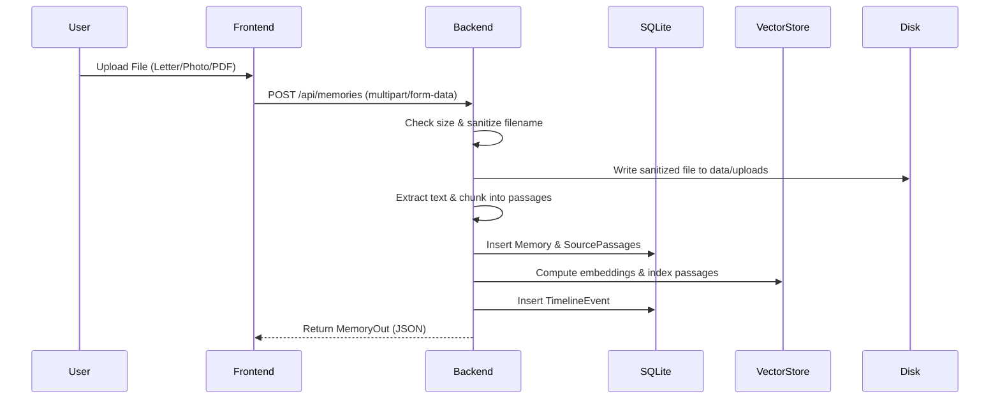
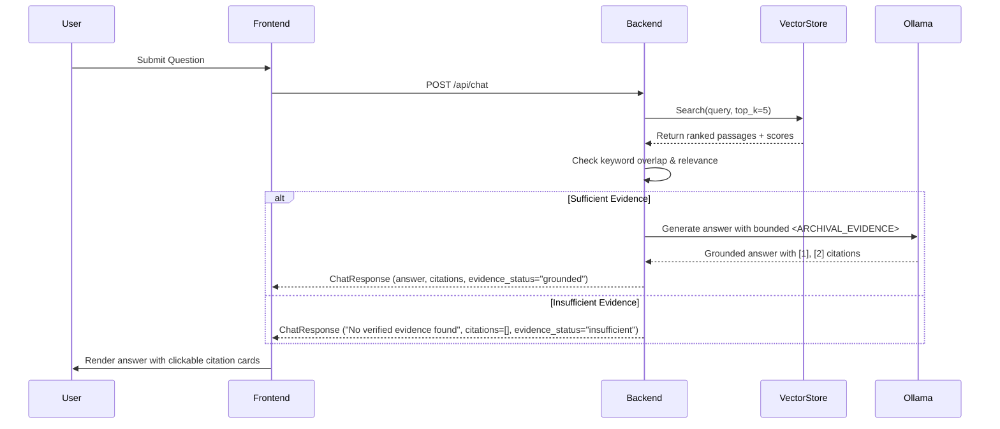

# System Architecture: EchoVault

## Architectural Principles

1. **Air-Gapped by Default**: Data never transits outside the user's workstation.
2. **Deterministic Attribution**: AI answers are anchored directly to stored passage IDs.
3. **Decoupled AI Engine**: The core product is completely independent of any single model provider.
4. **Polyglot Preservation**: Preserves raw files, extracted text, and structured metadata together.

## Structural Decomposition

```
EchoVault/
├── frontend/                     # Next.js 14 Presentation Layer
│   ├── app/                      # App Router Routes & Viewports
│   ├── components/               # Persistent Shell, Navigation, Citation Panels
│   └── lib/                      # API Client, TypeScript Domain Models
│
├── backend/                      # FastAPI Application Server
│   ├── app/
│   │   ├── main.py               # Server Lifecycle & Middleware
│   │   ├── database.py           # SQLite Schema & Connection Pool
│   │   ├── routes/               # Modular Endpoints
│   │   ├── services/             # Storage, Extraction, Vector, RAG
│   │   └── config.py             # Environment Configuration
│   └── tests/                    # Pytest Verification Suite
│
├── data/                         # Persistent Storage Mount
│   ├── echovault.db              # Relational Metadata & Passages
│   ├── vector_index.json         # Dense Embeddings
│   ├── uploads/                  # Original Files & Photos
│   └── exports/                  # Generated Portable ZIP Archives
│
└── compose.yaml                  # Podman / Docker Container Orchestration
```

## Data Flow Diagrams

### Ingestion Flow


### Evidence-Backed Retrieval Flow

