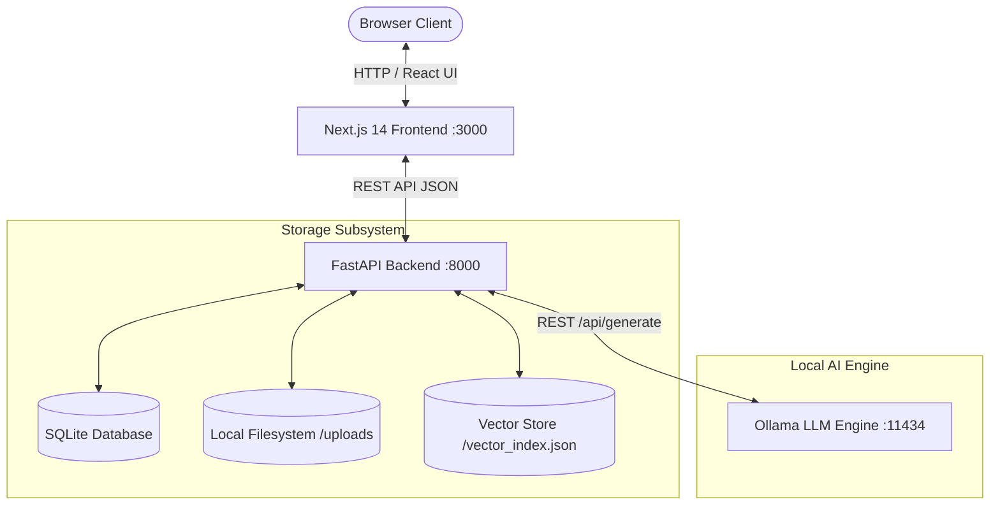

# Technical Requirements Document (TRD): EchoVault

## 1. System Architecture Overview
EchoVault is designed around a decoupled, local-first architecture consisting of:
- **Client Presentation Tier**: Next.js 14 App Router (React, TypeScript, Tailwind CSS, Lucide Icons) running on port 3000.
- **Application Server Tier**: FastAPI application running with Uvicorn on port 8000. Implements strict Pydantic v2 validation, content hashing, extraction pipelines, and RAG orchestration.
- **Persistence Tier**: SQLite 3 database operating with WAL mode and foreign key constraints enabled (`PRAGMA foreign_keys = ON;`), local filesystem storage for uploaded media assets (`data/uploads/`), and a JSON-backed dense vector index (`data/vector_index.json`).
- **AI Inference Tier**: Local open-weight inference via Ollama (`http://localhost:11434` or container bridge `http://host.containers.internal:11434`) with an offline deterministic fallback synthesizer.



## 2. Ingestion & Extraction Pipeline
1. **Validation**: Enforce 50MB file size limits and extension whitelisting (`.txt`, `.md`, `.pdf`, `.png`, `.jpg`, `.jpeg`, `.webp`, `.mp3`, `.wav`, `.m4a`).
2. **Path Traversal Defense**: Filenames are sanitized via regex (`[^a-zA-Z0-9_.-]`), assigned a 16-character SHA-256 prefix, and saved only within `data/uploads/` after strict relative path verification.
3. **Deduplication**: SHA-256 content hashes are calculated; duplicate submissions trigger an HTTP 409 Conflict with the existing record ID.
4. **Text Extraction**:
   - Plain text / Markdown: UTF-8 decoding with Latin-1 fallback.
   - PDF: Parsed via `pypdf.PdfReader` with page-by-page segmentation.
   - Images & Audio: Structured metadata attribution with support for user transcripts and annotations.
5. **Passage Chunking**: Documents are split into bounded passages (~400 characters, 50-character overlap) preserving page numbers.

## 3. Retrieval-Augmented Generation (RAG) Architecture
1. **Embedding**: Generated via Ollama `nomic-embed-text` or deterministic normalized 384-dimensional dense bag-of-words/n-gram vectorizer when offline.
2. **Retrieval**: Passages scored by cosine similarity, filtered by metadata (tags, source formats), and ranked.
3. **Prompt Bounding**: Retrieved passages are injected inside strict XML delimiters:
   ```xml
   <ARCHIVAL_EVIDENCE id="[1]" memory_title="..." date="...">
   [Passage text]
   </ARCHIVAL_EVIDENCE>
   ```
4. **Inference**: High-fidelity prompt sent to local Ollama (Llama 3.2, Qwen 2.5) with low temperature (0.1) enforcing bracketed citations (`[1]`, `[2]`).
5. **Uncertainty & Verification**: If query content words are absent from passages or similarity is below threshold, returns an explicit notice that archival evidence is insufficient.

## 4. Deployment Strategy
- Dual Containerfiles (`backend.Containerfile` and `frontend.Containerfile`).
- Podman-compatible `compose.yaml` with persistent named volume `echovault_data` and bridge network `echovault_network`.
